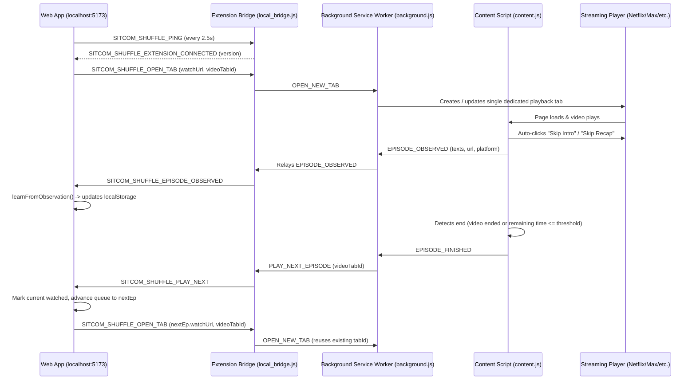

# SitcomShuffle - Project Handover Document

## 1. Executive Summary & Project Purpose

**SitcomShuffle** is a full-featured web application and companion browser extension designed to provide a "cable TV / shuffle" experience across multiple major streaming services (**Netflix**, **Disney+**, **HBO Max**, and **Amazon Prime Video**).

Instead of binge-watching a single sitcom in linear sequence or manually switching between different streaming platforms, SitcomShuffle allows users to:
1. Define a personalized playlist containing multiple sitcoms with weighted distribution (e.g., 2 episodes of *The Office* for every 1 episode of *Brooklyn Nine-Nine*).
2. Filter allowed seasons per show or load curated presets (e.g., Workplace Comedies, Netherlands Popular).
3. Generate a non-repeating randomized queue of episodes.
4. Seamlessly launch episodes in a reusable browser tab.
5. Automatically skip intros, skip recaps, detect episode endings, mark episodes as watched, and advance to the next queued show using the **SitcomShuffle Auto-Play Companion** Chrome Extension (Manifest V3).
6. Automatically learn and self-heal missing or broken streaming links by analyzing DOM playback metadata directly from the streaming players.

---

## 2. Technology Stack

### Web Application
- **Runtime & Build**: Node.js, [Vite 8.3](file:///c:/Users/afkav/.gemini/antigravity/scratch/sitcom-shuffle-app/vite.config.js) (React plugin).
- **Frontend Framework**: React 19 ([src/App.jsx](file:///c:/Users/afkav/.gemini/antigravity/scratch/sitcom-shuffle-app/src/App.jsx), [src/main.jsx](file:///c:/Users/afkav/.gemini/antigravity/scratch/sitcom-shuffle-app/src/main.jsx)).
- **Icons & Effects**: `lucide-react`, `canvas-confetti`.
- **Styling**: Modern Vanilla CSS ([src/index.css](file:///c:/Users/afkav/.gemini/antigravity/scratch/sitcom-shuffle-app/src/index.css)) featuring dark mode, glassmorphism, responsive grid layouts, custom scrollbars, and animations.
- **Linter**: `oxlint` (configured via [.oxlintrc.json](file:///c:/Users/afkav/.gemini/antigravity/scratch/sitcom-shuffle-app/.oxlintrc.json)).
- **Dev Server Port**: `http://localhost:5173` *(Note: shifted from 3000 to avoid Windows Hyper-V dynamic port exclusions)*.

### Browser Extension
- **Platform**: Chrome Extension Manifest V3 ([extension/manifest.json](file:///c:/Users/afkav/.gemini/antigravity/scratch/sitcom-shuffle-app/extension/manifest.json)).
- **Background Service Worker**: [extension/background.js](file:///c:/Users/afkav/.gemini/antigravity/scratch/sitcom-shuffle-app/extension/background.js) (tab lifecycle, secure origin validation, single-video-tab reuse via `chrome.storage.session`).
- **Content Scripts**:
  - [extension/content.js](file:///c:/Users/afkav/.gemini/antigravity/scratch/sitcom-shuffle-app/extension/content.js): Injected into streaming domains (`netflix.com`, `disneyplus.com`, `max.com`, `primevideo.com`). Interacts with video players, Shadow DOM, autoplay buttons, and metadata observers.
  - [extension/local_bridge.js](file:///c:/Users/afkav/.gemini/antigravity/scratch/sitcom-shuffle-app/extension/local_bridge.js): Injected into `localhost:5173` and `localhost:3000` to bridge `window.postMessage` with `chrome.runtime`.
- **Popup UI**: [extension/popup.html](file:///c:/Users/afkav/.gemini/antigravity/scratch/sitcom-shuffle-app/extension/popup.html), [extension/popup.js](file:///c:/Users/afkav/.gemini/antigravity/scratch/sitcom-shuffle-app/extension/popup.js).

### Data & Scraper Tooling
- Python 3 & Node.js scripts in [tools/](file:///c:/Users/afkav/.gemini/antigravity/scratch/sitcom-shuffle-app/tools) for scraping IDs and titles (Playwright, BeautifulSoup, DuckDuckGo, JustWatch, TVmaze, Wikidata).

---

## 3. Repository Architecture & Directory Layout

```
sitcom-shuffle-app/
├── package.json               # Dependencies, scripts (dev, build, lint, zip:ext)
├── vite.config.js             # Vite configuration (port 5173)
├── index.html                 # HTML shell
├── README.md                  # High-level personal documentation
├── handover.md                # Technical handover and architecture reference (this file)
│
├── extension/                 # Chrome Companion Extension (Manifest V3)
│   ├── manifest.json          # Manifest V3 definitions & host permissions
│   ├── background.js          # Background service worker (tab control & IPC relay)
│   ├── content.js             # Streaming site automation (skip intro, end detection, metadata scraping)
│   ├── local_bridge.js        # Web app bridge (connects React window <-> Extension)
│   ├── popup.html             # Extension status popup interface
│   └── popup.js              # Extension status popup logic
│
├── public/
│   └── sitcom-shuffle-extension.zip # Packaged extension bundle for user download
│
├── src/
│   ├── main.jsx               # React DOM entry point
│   ├── App.jsx                # Core application controller & state store
│   ├── index.css              # Complete design system & component styles
│   │
│   ├── components/
│   │   ├── Header.jsx         # App bar, autoplay toggle, extension status pill
│   │   ├── PlaylistBuilder.jsx# Rule creator, show list, weights, presets, reordering
│   │   ├── PlayerView.jsx     # Current episode spotlight, watch triggers, reroll
│   │   ├── QueueList.jsx      # Visual upcoming playlist queue (25 items)
│   │   └── modals/
│   │       ├── Modal.jsx      # Reusable modal backdrop & frame
│   │       ├── AddShowModal.jsx       # Show selection dialog
│   │       ├── EditLinkModal.jsx      # Manual URL configuration modal
│   │       ├── ExtensionGuideModal.jsx# Setup guide & learned link viewer
│   │       └── SeasonFilterModal.jsx  # Season toggle modal
│   │
│   ├── services/
│   │   ├── shuffleEngine.js   # Weighted shuffling, link resolution, platform quirks
│   │   └── linkLearner.js     # Text normalization, show identification, link auto-learning
│   │
│   └── data/
│       ├── sitcomsData.js     # Master show definitions, platforms, episode watch IDs, presets
│       └── episodeTitles.js   # Master episode title database mapped by show ID
│
└── tools/                     # Offline maintenance, data generation & scrapers
    ├── zip-extension.cjs      # Bundles extension/ into public/ extension zip
    ├── scrapers/              # Scraping scripts for TVmaze, JustWatch, Netflix, Max, etc.
    ├── data-build/            # Pipeline scripts compiling raw scrapes into src/data/
    ├── checks/                # Consistency checks (missing IDs, episode numbering)
    └── datasets/              # Cached raw JSON/HTML data
```

---

## 4. Key Subsystems & Core Logic

### 4.1 Queue Generation & Shuffling Engine (`src/services/shuffleEngine.js`)
- **Weighted Multi-Show Distribution**: Each show has a `count` weight (e.g. 2 of Show A, 1 of Show B). The generator produces a cycle matching these ratios, interleaves them randomly to prevent consecutive episodes of the same show when possible, and repeats until the queue length (default: 25) is fulfilled.
- **Season Filtering**: Shows support `allowedSeasons` arrays (e.g. `[1, 2, 3]`). If non-empty, only episodes from those seasons are eligible.
- **Watched Episode Filtering**: Previously watched episodes (persisted in `localStorage`) are excluded from pool generation until all episodes in the permitted scope have been exhausted, at which point the pool recycles.
- **Platform Quirks & Episode Mapping (`unavailableEpisodes`)**:
  - Example: *Community* Season 2 Episode 14 (*"Advanced Dungeons & Dragons"*) was removed by Netflix in 2020.
  - Netflix subsequently shifted its display numbering (original S02E15 is labeled S02E14 on Netflix).
  - The engine accounts for this via `getPlatformNumbering(show, platform, canonicalSeason, canonicalEp)`, keeping canonical metadata intact while presenting platform-accurate labels to the user.

### 4.2 Link Resolution Hierarchy
Every episode displayed in the UI has its target URL resolved using `resolveEpisodeLink`:
1. **User Custom Link** (`customLinks[`${showId}_${platformId}_${episodeCode}`]`): Highest priority. If the user explicitly pastes a link, it always wins.
2. **Legacy Custom Link** (`customLinks[`${showId}_${episodeCode}`]`): Backwards compatibility fallback if platform matches.
3. **Learned Link** (`customLinks[`learned:${showId}_${platformId}_${episodeCode}`]`): Captured by the companion extension during actual playback.
4. **Built-in Watch ID** (`show.episodeWatchIds[episodeCode]`): Formatted into platform URL (e.g., `https://www.netflix.com/watch/<id>`), provided it has not been marked as incorrect (`bad:...`).
5. **Missing Link Fallback**: If no link is found, returns `watchUrl: null`, prompting the user to either paste a link or let the extension learn it.

### 4.3 Self-Healing Link Learner (`src/services/linkLearner.js`)
When an episode is actively playing on Netflix, Disney+, or Max, the extension reads the on-screen title text, season/episode indicators, and current URL, and dispatches `SITCOM_SHUFFLE_EPISODE_OBSERVED` to the web app:
- **Normalization**: Strips accents, punctuation, and Turkish/special characters (`normalizeText`).
- **Show Identification**: Compares player titles against Turkish, English, and localized titles in `SITCOMS_DATABASE`.
- **Episode Matching**: Matches parsed Season/Episode numbers (`S2:E14`, `2. Sezon 14. Bölüm`) or title strings against [episodeTitles.js](file:///c:/Users/afkav/.gemini/antigravity/scratch/sitcom-shuffle-app/src/data/episodeTitles.js).
- **Link Learning Outcomes**:
  - `new`: Episode previously had no direct link; URL is saved to `sitcom_shuffle_learned_links`.
  - `replaced`: Built-in link existed, but extension found a different working direct link.
  - `bad`: An existing built-in link pointed to the wrong episode; flagged as `bad:` to disable it.
  - `confirmed` / `custom`: Built-in or user-provided link confirmed accurate; no changes made.

### 4.4 Extension Communication & Automation Pipeline
The automation loop between the web app and streaming tabs operates as follows:



---

## 5. Storage & Persistence Schema

All state is preserved in browser `localStorage`:

| Key | Type | Description |
|---|---|---|
| `sitcom_shuffle_rules` | `Array<Rule>` | Active playlist rules: `[{ showId, count, allowedSeasons, platform }]` |
| `sitcom_shuffle_rules_v2` | `string` | Initialization migration flag (`'true'`) |
| `sitcom_shuffle_autoplay` | `boolean` | Whether automated queue progression is active |
| `sitcom_shuffle_watched` | `Array<Episode>` | History of played episodes: `[{ showId, season, episode }]` |
| `sitcom_shuffle_custom_links` | `Record<string, string>` | User-entered URLs. Keys: `<showId>_<platform>_<SxxEyy>` or `<showId>_<platform>` |
| `sitcom_shuffle_learned_links` | `Record<string, string>` | Extension-learned URLs (`learned:...`) and invalid link flags (`bad:...`) |
| `sitcom_shuffle_learn_log` | `Array<LogEntry>` | Rolling 50-item log of links learned during playback |

---

## 6. Supported Shows & Current Link Coverage

The database currently holds 9 sitcoms in [src/data/sitcomsData.js](file:///c:/Users/afkav/.gemini/antigravity/scratch/sitcom-shuffle-app/src/data/sitcomsData.js) (Seinfeld, It's Always Sunny, Rick and Morty and New Girl were removed on 2026-10-08):

| Show ID | Title | Default Platform | Built-in Episode Links | Notes |
|---|---|---|---|---|
| `office` | The Office (US) | Netflix | **198 / 201** | Missing S03E12, S03E13, S03E15 due to duplicate scraper IDs |
| `b99` | Brooklyn Nine-Nine | Netflix | **153 / 153** | 100% complete |
| `community` | Community | Netflix | **109 / 110** | Missing S04E09. Special handler for removed S02E14 |
| `friends` | Friends | Netflix | **236 / 236** | 100% complete |
| `himym` | How I Met Your Mother | Disney+ | **208 / 208** | 100% complete |
| `modern-family` | Modern Family | Disney+ | **250 / 250** | 100% complete |
| `parks-and-rec` | Parks and Recreation | Prime Video | **125 / 125** | Uses episode URLs |
| `tbbt` | The Big Bang Theory | HBO Max | **279 / 279** | 100% complete with full Max watch URLs |
| `two-and-a-half-men` | Two and a Half Men | Prime Video | **262 / 262** | Episode URLs use `amzn1.dv.gti.*` IDs; raw scrape in `tools/datasets/tahm_prime_episodes.json` |

---

## 7. Developer & Operational Workflows

### 7.1 Running the App Locally
```bash
# Install dependencies
npm install

# Start Vite dev server on port 5173
npm run dev

# Lint codebase
npm run lint

# Build for production
npm run build
```

> [!NOTE]
> **Port 5173 Configuration**: Port 3000 is intentionally avoided on this machine because Windows Hyper-V / WinNAT dynamically reserves port ranges (specifically `2960 - 3059`), which triggers `listen EACCES: permission denied ::1:3000`. Port 5173 is configured across [vite.config.js](file:///c:/Users/afkav/.gemini/antigravity/scratch/sitcom-shuffle-app/vite.config.js), [extension/manifest.json](file:///c:/Users/afkav/.gemini/antigravity/scratch/sitcom-shuffle-app/extension/manifest.json), and [extension/background.js](file:///c:/Users/afkav/.gemini/antigravity/scratch/sitcom-shuffle-app/extension/background.js).

### 7.2 Loading and Updating the Chrome Extension
1. Open Google Chrome and navigate to `chrome://extensions`.
2. Enable **Developer mode** (top-right toggle).
3. Click **Load unpacked** and select the [extension/](file:///c:/Users/afkav/.gemini/antigravity/scratch/sitcom-shuffle-app/extension) directory.
4. When making edits to files in `extension/`, click the **Reload** icon on the extension card in `chrome://extensions`, then refresh both `localhost:5173` and any open streaming tabs.
5. If you modify extension files and want to update the downloadable bundle for end-users, run:
   ```bash
   npm run zip:ext
   ```
   *(Executes [tools/zip-extension.cjs](file:///c:/Users/afkav/.gemini/antigravity/scratch/sitcom-shuffle-app/tools/zip-extension.cjs), updating `public/sitcom-shuffle-extension.zip`).*

---

## 8. Known Issues & Future Recommendations

1. **Missing Specific Episodes in The Office and Community**:
   - The Office: `S03E12`, `S03E13`, `S03E15` are missing from Netflix watch IDs.
   - Community: `S04E09` is missing.
   - *Recommendation*: Extract exact Netflix watch IDs from a browser network trace and add directly to `episodeWatchIds` in `sitcomsData.js`.
2. **Prime Video URL Identification**:
   - Amazon Prime Video URLs do not contain predictable canonical season/episode slugs in player mode. The link learner currently bypasses Prime Video (`LEARNABLE_PLATFORMS = ['netflix', 'disney', 'max']`).
   - *Recommendation*: Investigate reading Prime Video's internal player title API or X-Ray DOM overlay to support learned links on Prime.
3. **Git Repository Initialization**:
   - The project is currently not initialized as a git repository in this folder.
   - *Recommendation*: Run `git init`, set up `.gitignore` (ignoring `node_modules`, `dist`, `.DS_Store`), and commit the initial baseline.
